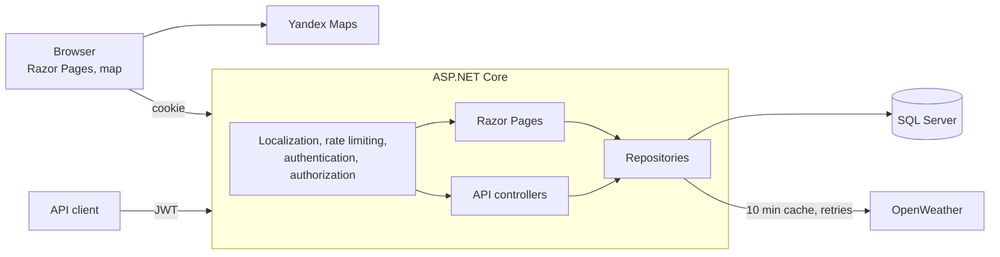

# TrackWeatherMap (TrackWeather)

[](https://github.com/qwiklly/TrackWeather/actions/workflows/ci.yml)


[Русский](README.md) · **English**

An ASP.NET Core web application: current weather at any point on a map, routes to the chosen point, and a dedicated map of special transport requests for utility services.

## Features

- **Weather at a point.** Right-click the map to place a marker and see the current OpenWeather conditions in the interface language. Responses are cached for 10 minutes.
- **Routes.** From your location or from an address, with distance and travel time (Yandex Maps).
- **Special transport.** Users create requests through the API; administrators see them on a map and in a table.
- **Administration.** Users and roles; you cannot delete yourself or the last administrator.
- **Two languages.** Russian and English with a switcher in the header.
- **REST API.** Swagger, JWT and a uniform ProblemDetails error format.

## Screenshots

<p>
  
  
</p>
<p>
  
  
</p>
<p></p>

## Stack

.NET 10 · ASP.NET Core (Razor Pages + Web API) · EF Core · SQL Server · JWT and cookie authentication · Serilog · Polly · xUnit · Docker · GitHub Actions

## Architecture



Notable decisions:

- **Closed by default.** A global policy requires sign-in; public pages and actions are explicitly marked `[AllowAnonymous]`.
- **Two authentication schemes.** Browsers use an HttpOnly cookie, API clients use a JWT. The `Authorization` header selects the scheme.
- **Roles never come from the client.** Public registration always creates a regular user, and the author of a transport request is taken from the token.
- **Secrets stay out of the repository.** Settings are validated at startup; without a JWT key the app refuses to start and says why.

## Localization

Texts live in [`Resources/SharedResource.resx`](TrackWeatherWeb/Resources/SharedResource.resx) and [`SharedResource.en.resx`](TrackWeatherWeb/Resources/SharedResource.en.resx). The RU/EN switcher works without JavaScript and keeps you on the current page. The choice is stored in a cookie; on a first visit the language comes from the browser.

The interface, validation errors, API responses, weather descriptions and the map itself are all translated. Tests verify that both files have the same keys, that every key used in code exists, and that markup contains no hardcoded text.

## Quick start

### Docker

You need Docker and, for the map and weather, [Yandex Maps](https://developer.tech.yandex.ru) and [OpenWeather](https://openweathermap.org/api) keys.

```bash
cp .env.example .env
```

Fill in `.env`, then start it:

```bash
docker compose up --build
```

The app runs at <http://localhost:5180>, Swagger at <http://localhost:5180/swagger> and the health check at <http://localhost:5180/health>. The administrator is created from `SEED_ADMIN_EMAIL` and `SEED_ADMIN_PASSWORD`.

### Locally

You need the .NET 10 SDK and SQL Server. The development connection string is in `appsettings.Development.json`.

```bash
cd TrackWeatherWeb
dotnet user-secrets set "Jwt:Key" "random-string-of-at-least-32-characters"
dotnet user-secrets set "YandexMaps:ApiKey" "your-key"
dotnet user-secrets set "OpenWeatherApi:ApiKey" "your-key"
dotnet user-secrets set "Seed:AdminEmail" "you@example.com"
dotnet user-secrets set "Seed:AdminPassword" "a-strong-password"
dotnet ef database update
dotnet run --launch-profile https
```

### Upgrading an existing database

The `HardenSchema` migration renames columns while keeping the data, shortens field lengths and adds a unique index on email. If the database contains duplicate emails the migration stops with an error, so remove them first. Back up the database before applying it.

## Tests

```bash
dotnet test
```

- **UnitTests** cover controllers and `WeatherRepo`: caching, coordinate formatting under the Russian culture, and keeping the API key out of errors.
- **IntegrationTests** run the whole app through `WebApplicationFactory` on SQLite: access rules, forged tokens and cookies, privilege escalation, XSS, login rate limiting, language switching and translation completeness.

Integration tests do not cover SQL Server migrations or Yandex Maps in a browser.

## API

| Method | Path | Access | Purpose |
|---|---|---|---|
| POST | `/api/auth/register` | public | Sign up |
| POST | `/api/auth/login` | public | Get a JWT |
| GET | `/api/weather?lat=&lon=` | signed in | Weather at a point |
| POST | `/api/transport-requests` | signed in | Request transport |
| GET | `/api/transport-requests`, `/{id}` | admin | View requests |
| PUT, DELETE | `/api/transport-requests/{id}` | admin | Update and delete |
| GET, POST | `/api/users` | admin | List and create users |
| GET, PUT, DELETE | `/api/users/{email}` | admin | View, update, delete |
| GET | `/health` | public | App and database status |

See Swagger for the full description.

## Roadmap

- Weather along the whole route with dangerous segments highlighted.
- Multi-day forecasts and weather alerts.
- Creating transport requests right from the map, with fulfilment statuses.
