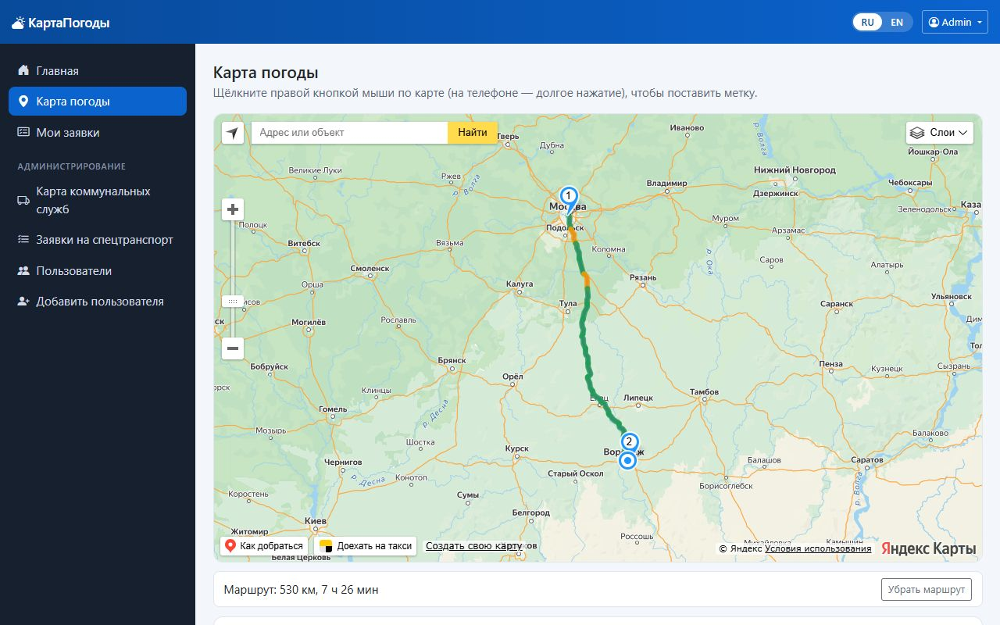
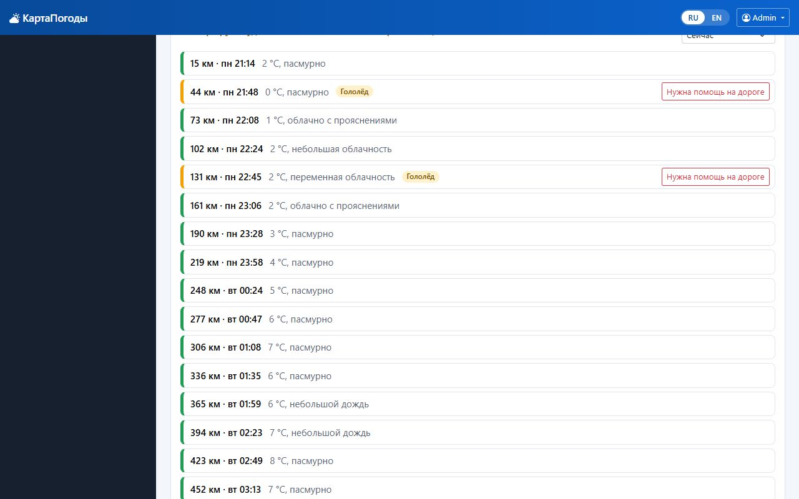
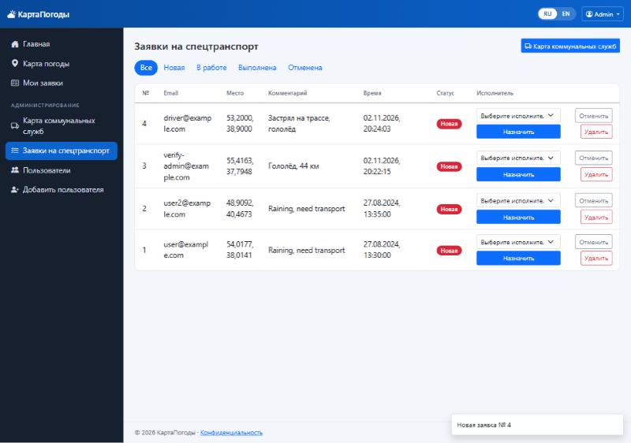
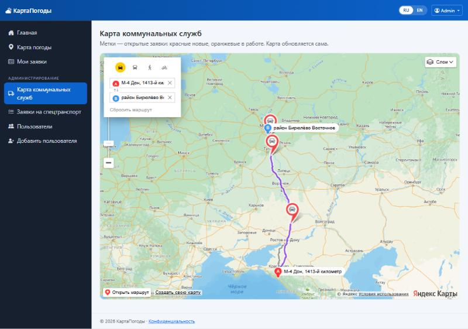
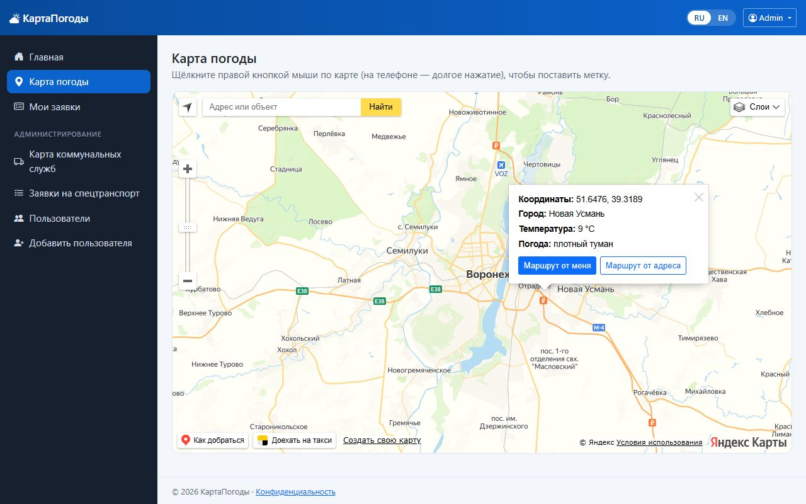
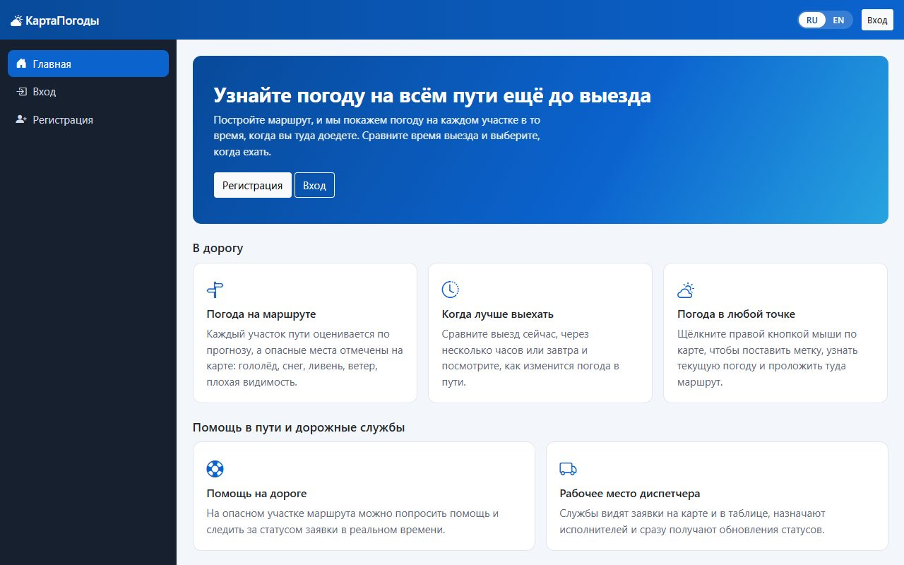
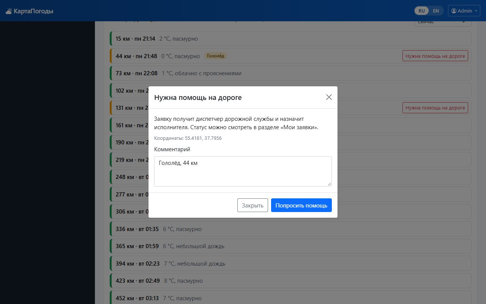
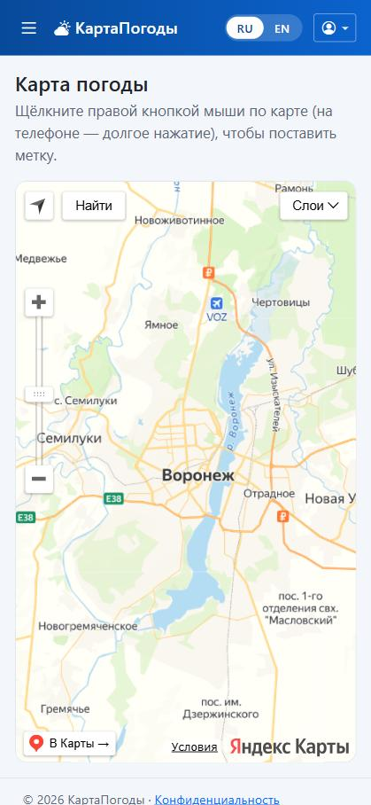
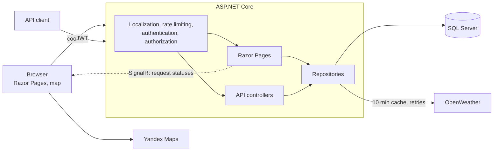

# TrackWeatherMap (TrackWeather)

[](https://github.com/qwiklly/TrackWeather/actions/workflows/ci.yml)


[Русский](README.md) · **English**

An ASP.NET Core web application for trips: it shows the weather on every stretch of a route at the time you get there. If you need help on the way, a request goes straight to a road service dispatcher.

## Features

- **Weather along the route.** A route is split into stretches, each rated by the forecast for when you get there. Dangerous stretches are coloured on the map and listed with the reason: ice, snow, heavy rain, wind, poor visibility or a thunderstorm. You can compare departure times.
- **Roadside help.** Send a request from a dangerous stretch of a route. Statuses: new → in progress → completed or cancelled. Authors and assignees see their requests on a dedicated page.
- **Dispatcher workspace.** Requests with a status filter and assignment, open requests on a map. New requests and status changes arrive instantly, without a page reload (SignalR).
- **Weather at a point.** Right-click the map to place a marker and see the current OpenWeather conditions in the interface language.
- **Routes.** From your location or from an address, with distance and travel time (Yandex Maps).
- **Administration.** Users and roles; you cannot delete yourself or the last administrator.
- **Two languages.** Russian and English with a switcher in the header.
- **REST API.** Swagger, JWT and a uniform ProblemDetails error format.

## Screenshots

<p>
  
  
</p>
<p>
  
  
</p>
<p>
  
  
</p>
<p></p>
<p></p>

## Stack

.NET 10 · ASP.NET Core (Razor Pages + Web API) · SignalR · EF Core · SQL Server · JWT and cookie authentication · Serilog · Polly · xUnit · Docker · GitHub Actions

## Architecture



Notable decisions:

- **Closed by default.** A global policy requires sign-in; public pages and actions are explicitly marked `[AllowAnonymous]`.
- **Two authentication schemes.** Browsers use an HttpOnly cookie, API clients use a JWT. The `Authorization` header selects the scheme.
- **Roles never come from the client.** Public registration always creates a regular user, and the author of a transport request is taken from the token.
- **Secrets stay out of the repository.** Settings are validated at startup; without a JWT key the app refuses to start and says why.
- **API quota care.** A route costs at most 20 forecast requests, responses are cached for 30 minutes per cell of about 10 km, and each user has a per-minute budget. If the forecast fails for one point, that point is marked unknown rather than safe.
- **Statuses as a state machine.** Transitions and permissions live in one class, and a concurrency token stops two dispatchers from changing a request at once.

Risk thresholds are practical estimates, not an official road safety standard. Arrival times come from the Yandex route without future traffic, and the forecast has a 3 hour step.

## Localization

Texts live in [`Resources/SharedResource.resx`](TrackWeatherWeb/Resources/SharedResource.resx) and [`SharedResource.en.resx`](TrackWeatherWeb/Resources/SharedResource.en.resx). The RU/EN switcher works without JavaScript and keeps you on the current page. The choice is stored in a cookie; on a first visit the language comes from the browser.

The interface, validation errors, API responses, weather descriptions and the map itself are all translated. Tests verify that both files have the same keys, that every key used in code exists, and that markup contains no hardcoded text.

## Quick start

### Docker

You need Docker and, for the map and weather, [Yandex Maps](https://developer.tech.yandex.ru) and [OpenWeather](https://openweathermap.org/api) keys.

```bash
cp .env.example .env
```

Fill in `.env`, then start it:

```bash
docker compose up --build
```

The app runs at <http://localhost:5180>, Swagger at <http://localhost:5180/swagger> and the health check at <http://localhost:5180/health>. The administrator is created from `SEED_ADMIN_EMAIL` and `SEED_ADMIN_PASSWORD`.

### Locally

You need the .NET 10 SDK and SQL Server. The development connection string is in `appsettings.Development.json`.

```bash
cd TrackWeatherWeb
dotnet user-secrets set "Jwt:Key" "random-string-of-at-least-32-characters"
dotnet user-secrets set "YandexMaps:ApiKey" "your-key"
dotnet user-secrets set "OpenWeatherApi:ApiKey" "your-key"
dotnet user-secrets set "Seed:AdminEmail" "you@example.com"
dotnet user-secrets set "Seed:AdminPassword" "a-strong-password"
dotnet ef database update
dotnet run --launch-profile https
```

### Upgrading an existing database

The `HardenSchema` migration renames columns while keeping the data, shortens field lengths and adds a unique index on email. If the database contains duplicate emails the migration stops with an error, so remove them first. The `TransportWorkflow` migration adds the status and assignee, and existing requests become new. Back up the database before applying them.

## Tests

```bash
dotnet test
```

- **UnitTests** cover risk rules, route splitting, choosing the forecast by arrival time, status transitions, controllers and `WeatherRepo`.
- **IntegrationTests** run the whole app through `WebApplicationFactory` on SQLite: access rules, forged tokens and cookies, privilege escalation, XSS, rate limits, the request lifecycle, SignalR delivery, language switching and translation completeness.

Automated tests do not cover SQL Server migrations or Yandex Maps in a browser; those are checked by hand.

## API

| Method | Path | Access | Purpose |
|---|---|---|---|
| POST | `/api/auth/register` | public | Sign up |
| POST | `/api/auth/login` | public | Get a JWT |
| GET | `/api/weather?lat=&lon=` | signed in | Weather at a point |
| POST | `/api/weather/route` | signed in | Assess the weather along a route |
| POST | `/api/transport-requests` | signed in | Create a request |
| GET | `/api/transport-requests/mine` | signed in | Your requests |
| GET | `/api/transport-requests?status=`, `/{id}` | admin | View requests |
| POST | `/api/transport-requests/{id}/assign` | admin | Assign an executor |
| POST | `/api/transport-requests/{id}/complete` | admin, assignee | Complete a request |
| POST | `/api/transport-requests/{id}/cancel` | admin, author of a new request | Cancel a request |
| PUT, DELETE | `/api/transport-requests/{id}` | admin | Update and delete |
| GET, POST | `/api/users` | admin | List and create users |
| GET, PUT, DELETE | `/api/users/{email}` | admin | View, update, delete |
| GET | `/health` | public | App and database status |

See Swagger for the full description. Live updates arrive through the `/hubs/transport` SignalR hub as `requestChanged` events.

## Roadmap

- Weather alerts for saved routes by email or Telegram.
- Multi-day forecasts and weather layers on the map.
- An analytics dashboard: requests by day and area.
