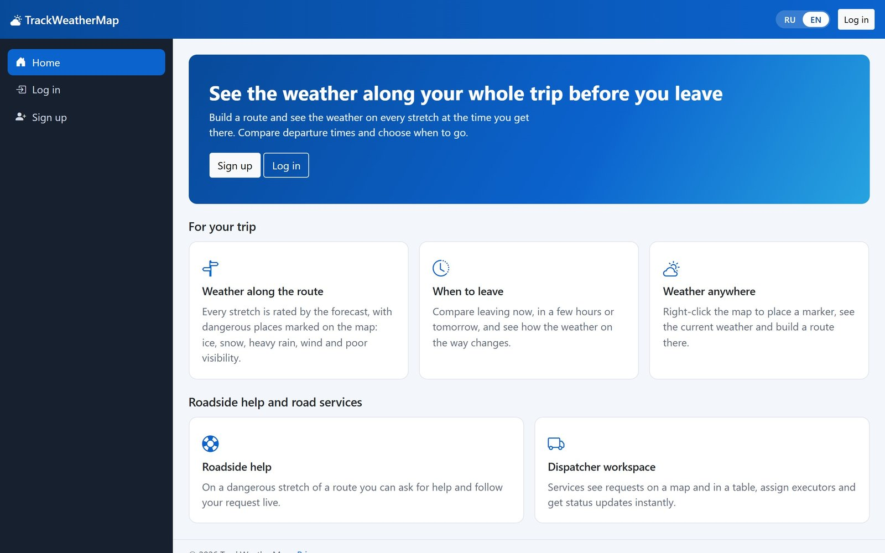
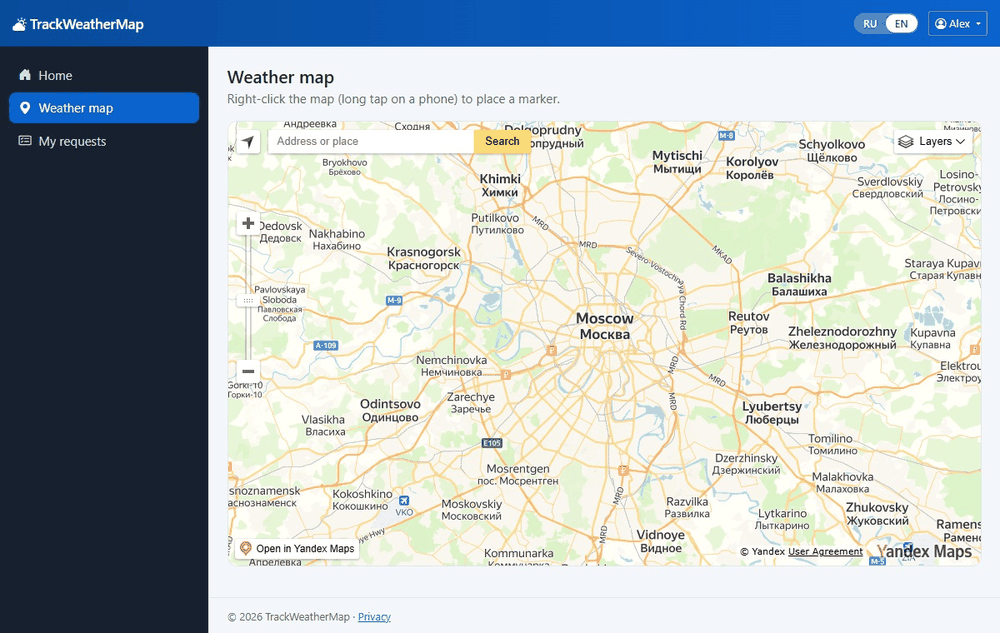
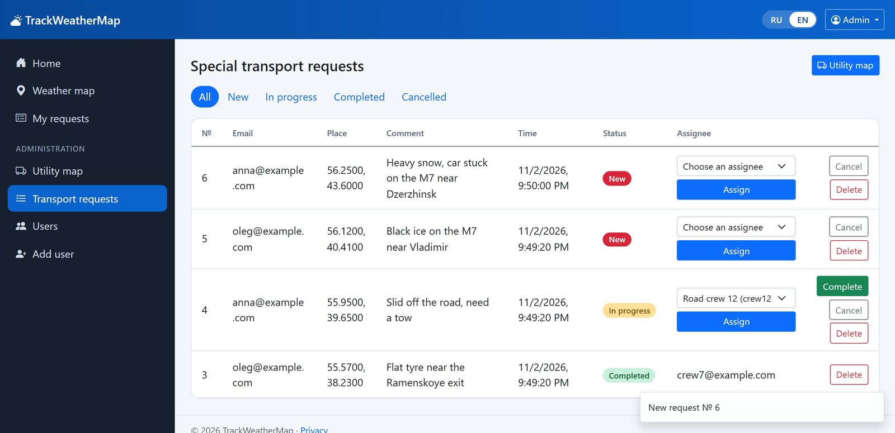
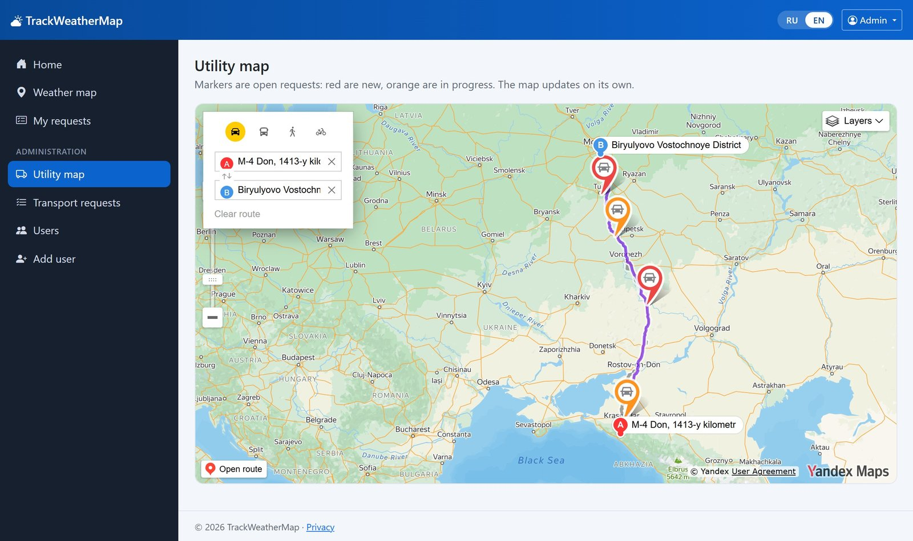

# TrackWeather

[](https://github.com/qwiklly/TrackWeather/actions/workflows/ci.yml)

TrackWeather is an application for monitoring weather conditions and planning routes based on weather forecasts. It is designed for travelers and technical services, including emergency response services, that need to react quickly to changing weather conditions.

**Tech stack:** ASP.NET Core 10 (Razor Pages and Web API), EF Core, SQL Server, SignalR, Polly, Serilog, xUnit, Docker and GitHub Actions.



The app takes weather forecasts along the entire route into account and warns users about hazardous conditions such as icy roads, snowfall, heavy rain, strong winds, poor visibility and thunderstorms. Users can also change the departure time and compare the updated forecast with the original one.



Users can submit a request to a dispatcher for assistance on hazardous sections of the route. The dispatcher assigns a road crew, and the request status is updated automatically.

## Request management

| Dispatcher's request list | Open requests on the dispatcher's map |
| --- | --- |
|  |  |

## Interface

The application interface is available in English and Russian. [README in Russian](README.ru.md)

## Getting started

You'll need API keys for [Yandex Maps](https://developer.tech.yandex.ru) and [OpenWeather](https://openweathermap.org/api).

### Running with Docker

```bash
cp .env.example .env
```

Fill in the required values in `.env`, then run:

```bash
docker compose up --build
```

Once the application is running, open http://localhost:5180. API documentation is available at `/swagger`.

### Running without Docker

You'll need the .NET 10 SDK and SQL Server. The connection string is configured in `appsettings.Development.json`.

```bash
cd TrackWeatherWeb
dotnet user-secrets set "YandexMaps:ApiKey" "your-key"
dotnet user-secrets set "OpenWeatherApi:ApiKey" "your-key"
dotnet ef database update
dotnet run --launch-profile https
```

A default admin account is created in a new local database:

- Email: `admin@example.com`
- Password: `Admin123`

These credentials are only intended for the Development environment.

### Running tests

Run the tests using:

```bash
dotnet test
```
