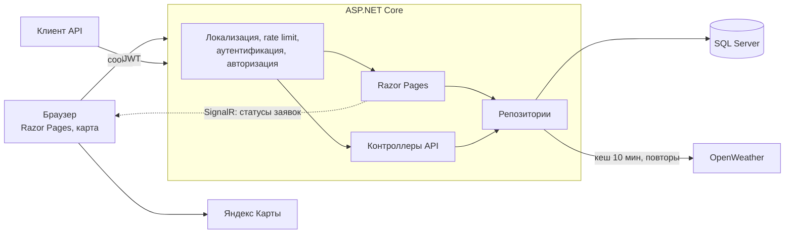

# КартаПогоды (TrackWeather)

[](https://github.com/qwiklly/TrackWeather/actions/workflows/ci.yml)


**Русский** · [English](README.en.md)

Веб-приложение на ASP.NET Core для поездок: показывает погоду на каждом участке маршрута в то время, когда вы туда доедете. Если в пути нужна помощь, заявка сразу попадает к диспетчеру дорожной службы.

## Возможности

- **Погода вдоль маршрута.** Маршрут делится на участки, и для каждого берётся прогноз на время, когда вы туда доедете. Опасные участки окрашиваются на карте и перечисляются с причиной: гололёд, снег, ливень, ветер, плохая видимость, гроза. Можно сравнить разное время выезда.
- **Помощь на дороге.** На опасном участке маршрута можно отправить заявку. Статусы: новая → в работе → выполнена или отменена. Автор и исполнитель видят свои заявки на отдельной странице.
- **Рабочее место диспетчера.** Заявки, фильтр по статусу и назначение исполнителя, открытые заявки на карте. Новые заявки и смена статусов приходят сразу, без перезагрузки страницы (SignalR).
- **Погода в точке.** Правый клик по карте ставит метку и показывает текущую погоду от OpenWeather на языке интерфейса.
- **Маршруты.** От вашего местоположения или от адреса, с длиной и временем в пути (Яндекс Карты).
- **Администрирование.** Пользователи и роли; нельзя удалить себя и последнего администратора.
- **Два языка.** Русский и английский с переключателем в шапке.
- **REST API.** Swagger, JWT, единый формат ошибок ProblemDetails.

## Интерфейс

<p>
  
  
</p>
<p>
  
  
</p>
<p>
  
  
</p>
<p></p>
<p></p>

## Стек

.NET 10 · ASP.NET Core (Razor Pages + Web API) · SignalR · EF Core · SQL Server · JWT и cookie-аутентификация · Serilog · Polly · xUnit · Docker · GitHub Actions

## Архитектура



Заметные решения:

- **Закрыто по умолчанию.** Глобальная политика требует вход; публичные страницы и методы явно помечены `[AllowAnonymous]`.
- **Две схемы входа.** Браузер использует HttpOnly-cookie, клиенты API — JWT. Схему выбирает заголовок `Authorization`.
- **Роль не приходит от клиента.** Публичная регистрация всегда создаёт обычного пользователя, автор запроса на транспорт берётся из токена.
- **Секреты вне репозитория.** Настройки проверяются при запуске; без ключа JWT приложение не стартует и объясняет почему.
- **Экономия лимитов API.** На маршрут уходит не больше 20 запросов прогноза, ответы кешируются на 30 минут по ячейкам около 10 км, а у каждого пользователя есть лимит проверок в минуту. Если прогноз не загрузился для одной точки, она помечается как неизвестная, а не безопасная.
- **Статусы как конечный автомат.** Переходы и права собраны в одном классе, а токен параллелизма не даёт двум диспетчерам одновременно изменить заявку.

Пороги риска — практическая оценка, а не официальный стандарт дорожной безопасности. Время прибытия рассчитывается по маршруту Яндекса без учёта будущих пробок, а прогноз имеет шаг 3 часа.

## Локализация

Тексты лежат в [`Resources/SharedResource.resx`](TrackWeatherWeb/Resources/SharedResource.resx) и [`SharedResource.en.resx`](TrackWeatherWeb/Resources/SharedResource.en.resx). Переключатель RU/EN работает без JavaScript и оставляет на текущей странице. Выбор хранится в cookie, а при первом визите язык определяется по браузеру.

Переводятся интерфейс, ошибки валидации, ответы API, описание погоды и сама карта. Тесты проверяют, что ключи совпадают в обоих файлах, что каждый ключ из кода существует и что в разметке нет текста, вписанного напрямую.

## Быстрый старт

### Docker

Нужны Docker и, для карты и погоды, ключи [Яндекс Карт](https://developer.tech.yandex.ru) и [OpenWeather](https://openweathermap.org/api).

```bash
cp .env.example .env
```

Заполните `.env`, затем запустите:

```bash
docker compose up --build
```

Приложение откроется на <http://localhost:5180>, Swagger — на <http://localhost:5180/swagger>, проверка состояния — на <http://localhost:5180/health>. Администратор создаётся из `SEED_ADMIN_EMAIL` и `SEED_ADMIN_PASSWORD`.

### Локально

Нужны .NET 10 SDK и SQL Server. Строка подключения для разработки находится в `appsettings.Development.json`.

```bash
cd TrackWeatherWeb
dotnet user-secrets set "Jwt:Key" "случайная-строка-не-короче-32-символов"
dotnet user-secrets set "YandexMaps:ApiKey" "ваш-ключ"
dotnet user-secrets set "OpenWeatherApi:ApiKey" "ваш-ключ"
dotnet user-secrets set "Seed:AdminEmail" "you@example.com"
dotnet user-secrets set "Seed:AdminPassword" "надёжный-пароль"
dotnet ef database update
dotnet run --launch-profile https
```

### Обновление существующей базы

Миграция `HardenSchema` переименовывает столбцы с сохранением данных, сокращает длины полей и добавляет уникальный индекс на email. Если в базе есть повторяющиеся email, миграция остановится с ошибкой: дубликаты нужно убрать заранее. Миграция `TransportWorkflow` добавляет статус и исполнителя, существующие заявки становятся новыми. Перед применением сделайте резервную копию.

## Тесты

```bash
dotnet test
```

- **UnitTests** — правила оценки риска, разбиение маршрута, выбор прогноза по времени прибытия, переходы статусов, контроллеры и `WeatherRepo`.
- **IntegrationTests** — приложение целиком через `WebApplicationFactory` на SQLite: права доступа, поддельные токены и cookie, повышение привилегий, XSS, лимиты запросов, жизненный цикл заявок, доставка уведомлений через SignalR, переключение языка, полнота переводов.

Автотесты не проверяют миграции SQL Server и работу карт Яндекса в браузере: это проверяется вручную.

## API

| Метод | Адрес | Доступ | Назначение |
|---|---|---|---|
| POST | `/api/auth/register` | все | Регистрация |
| POST | `/api/auth/login` | все | Получение JWT |
| GET | `/api/weather?lat=&lon=` | вход | Погода в точке |
| POST | `/api/weather/route` | вход | Оценка погоды вдоль маршрута |
| POST | `/api/transport-requests` | вход | Создание заявки |
| GET | `/api/transport-requests/mine` | вход | Мои заявки |
| GET | `/api/transport-requests?status=`, `/{id}` | админ | Просмотр заявок |
| POST | `/api/transport-requests/{id}/assign` | админ | Назначение исполнителя |
| POST | `/api/transport-requests/{id}/complete` | админ, исполнитель | Завершение заявки |
| POST | `/api/transport-requests/{id}/cancel` | админ, автор новой заявки | Отмена заявки |
| PUT, DELETE | `/api/transport-requests/{id}` | админ | Изменение и удаление |
| GET, POST | `/api/users` | админ | Список и создание пользователей |
| GET, PUT, DELETE | `/api/users/{email}` | админ | Просмотр, изменение, удаление |
| GET | `/health` | все | Состояние приложения и базы |

Полное описание — в Swagger. Уведомления приходят через хаб SignalR `/hubs/transport`, событие `requestChanged`.

## Планы

- Погодные оповещения по сохранённым маршрутам: письмо или Telegram.
- Прогноз на несколько дней и погодные слои на карте.
- Панель аналитики: заявки по дням и районам.
