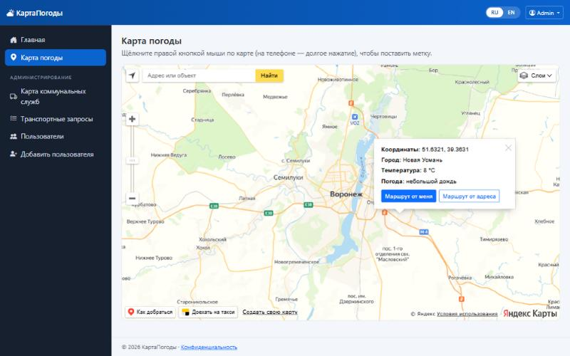
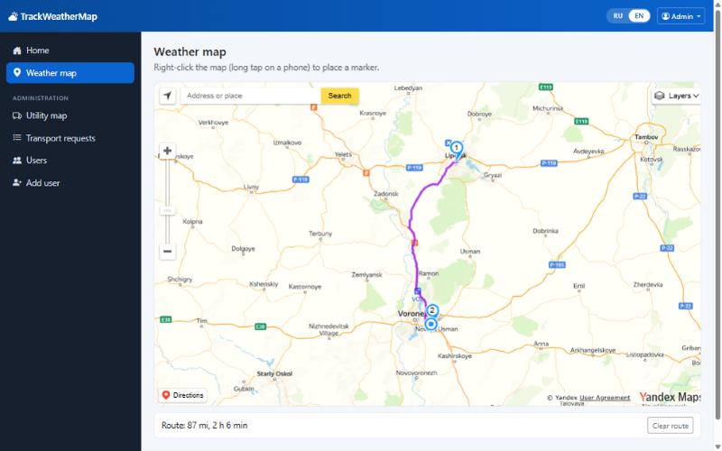
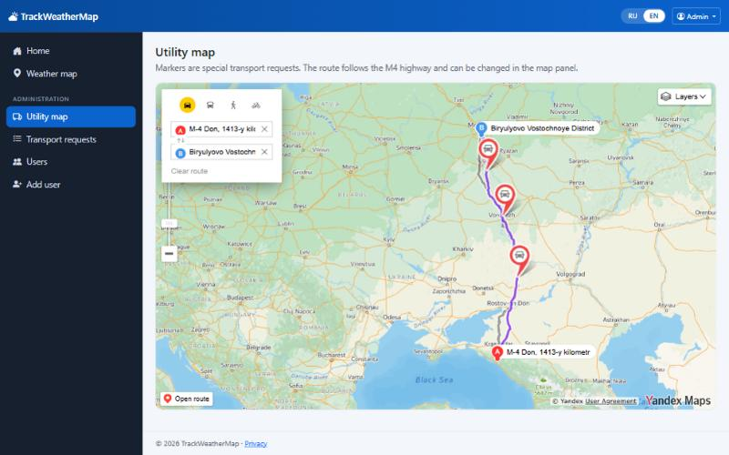
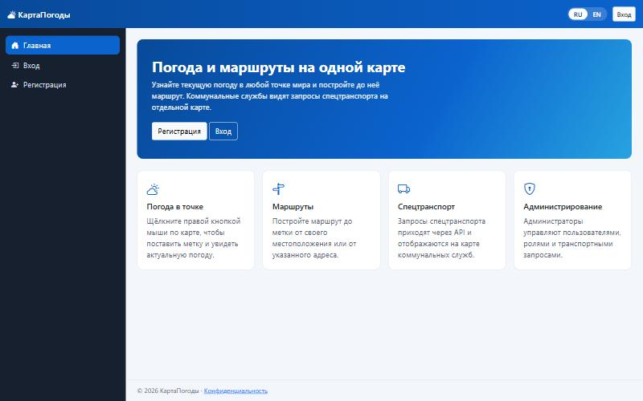
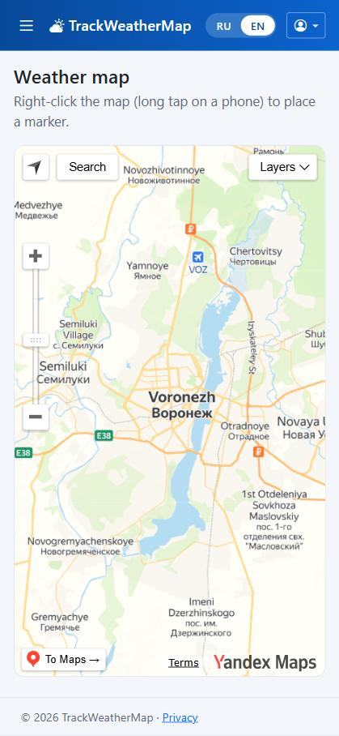
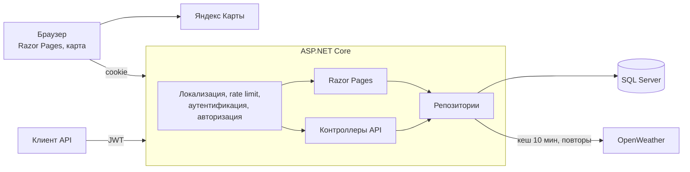

# КартаПогоды (TrackWeather)

[](https://github.com/qwiklly/TrackWeather/actions/workflows/ci.yml)


**Русский** · [English](README.en.md)

Веб-приложение на ASP.NET Core: текущая погода в любой точке карты, маршруты до выбранной точки и отдельная карта запросов спецтранспорта для коммунальных служб.

## Возможности

- **Погода в точке.** Правый клик по карте ставит метку и показывает текущую погоду от OpenWeather на языке интерфейса. Ответы кешируются на 10 минут.
- **Маршруты.** От вашего местоположения или от адреса, с длиной и временем в пути (Яндекс Карты).
- **Спецтранспорт.** Пользователи создают запросы через API, администраторы видят их на карте и в таблице.
- **Администрирование.** Пользователи и роли; нельзя удалить себя и последнего администратора.
- **Два языка.** Русский и английский с переключателем в шапке.
- **REST API.** Swagger, JWT, единый формат ошибок ProblemDetails.

## Интерфейс

<p>
  
  
</p>
<p>
  
  
</p>
<p></p>

## Стек

.NET 10 · ASP.NET Core (Razor Pages + Web API) · EF Core · SQL Server · JWT и cookie-аутентификация · Serilog · Polly · xUnit · Docker · GitHub Actions

## Архитектура



Заметные решения:

- **Закрыто по умолчанию.** Глобальная политика требует вход; публичные страницы и методы явно помечены `[AllowAnonymous]`.
- **Две схемы входа.** Браузер использует HttpOnly-cookie, клиенты API — JWT. Схему выбирает заголовок `Authorization`.
- **Роль не приходит от клиента.** Публичная регистрация всегда создаёт обычного пользователя, автор запроса на транспорт берётся из токена.
- **Секреты вне репозитория.** Настройки проверяются при запуске; без ключа JWT приложение не стартует и объясняет почему.

## Локализация

Тексты лежат в [`Resources/SharedResource.resx`](TrackWeatherWeb/Resources/SharedResource.resx) и [`SharedResource.en.resx`](TrackWeatherWeb/Resources/SharedResource.en.resx). Переключатель RU/EN работает без JavaScript и оставляет на текущей странице. Выбор хранится в cookie, а при первом визите язык определяется по браузеру.

Переводятся интерфейс, ошибки валидации, ответы API, описание погоды и сама карта. Тесты проверяют, что ключи совпадают в обоих файлах, что каждый ключ из кода существует и что в разметке нет текста, вписанного напрямую.

## Быстрый старт

### Docker

Нужны Docker и, для карты и погоды, ключи [Яндекс Карт](https://developer.tech.yandex.ru) и [OpenWeather](https://openweathermap.org/api).

```bash
cp .env.example .env
```

Заполните `.env`, затем запустите:

```bash
docker compose up --build
```

Приложение откроется на <http://localhost:5180>, Swagger — на <http://localhost:5180/swagger>, проверка состояния — на <http://localhost:5180/health>. Администратор создаётся из `SEED_ADMIN_EMAIL` и `SEED_ADMIN_PASSWORD`.

### Локально

Нужны .NET 10 SDK и SQL Server. Строка подключения для разработки находится в `appsettings.Development.json`.

```bash
cd TrackWeatherWeb
dotnet user-secrets set "Jwt:Key" "случайная-строка-не-короче-32-символов"
dotnet user-secrets set "YandexMaps:ApiKey" "ваш-ключ"
dotnet user-secrets set "OpenWeatherApi:ApiKey" "ваш-ключ"
dotnet user-secrets set "Seed:AdminEmail" "you@example.com"
dotnet user-secrets set "Seed:AdminPassword" "надёжный-пароль"
dotnet ef database update
dotnet run --launch-profile https
```

### Обновление существующей базы

Миграция `HardenSchema` переименовывает столбцы с сохранением данных, сокращает длины полей и добавляет уникальный индекс на email. Если в базе есть повторяющиеся email, миграция остановится с ошибкой: дубликаты нужно убрать заранее. Перед применением сделайте резервную копию.

## Тесты

```bash
dotnet test
```

- **UnitTests** — контроллеры и `WeatherRepo`: кеш, формат координат при русской культуре, отсутствие ключа API в ошибках.
- **IntegrationTests** — приложение целиком через `WebApplicationFactory` на SQLite: права доступа, поддельные токены и cookie, повышение привилегий, XSS, ограничение попыток входа, переключение языка, полнота переводов.

Интеграционные тесты не проверяют миграции SQL Server и работу карт Яндекса в браузере.

## API

| Метод | Адрес | Доступ | Назначение |
|---|---|---|---|
| POST | `/api/auth/register` | все | Регистрация |
| POST | `/api/auth/login` | все | Получение JWT |
| GET | `/api/weather?lat=&lon=` | вход | Погода в точке |
| POST | `/api/transport-requests` | вход | Запрос транспорта |
| GET | `/api/transport-requests`, `/{id}` | админ | Просмотр запросов |
| PUT, DELETE | `/api/transport-requests/{id}` | админ | Изменение и удаление |
| GET, POST | `/api/users` | админ | Список и создание пользователей |
| GET, PUT, DELETE | `/api/users/{email}` | админ | Просмотр, изменение, удаление |
| GET | `/health` | все | Состояние приложения и базы |

Полное описание — в Swagger.

## Планы

- Погода вдоль всего маршрута с подсветкой опасных участков.
- Прогноз на несколько дней и погодные оповещения.
- Создание запроса на транспорт прямо с карты и статусы его выполнения.
