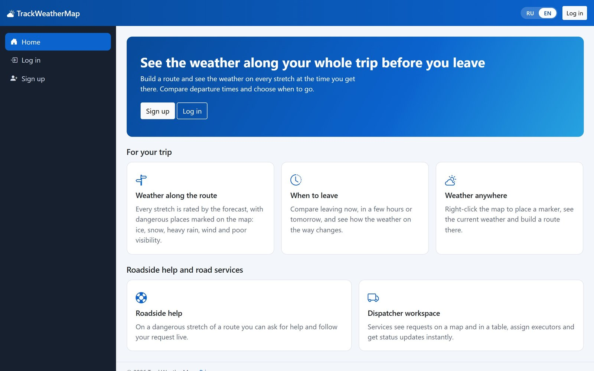
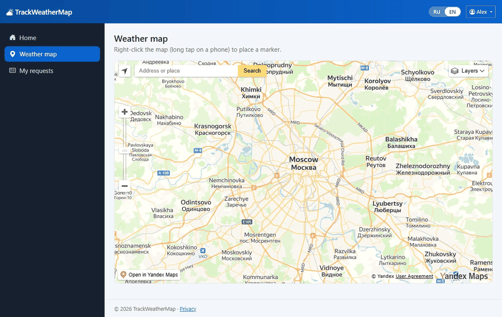
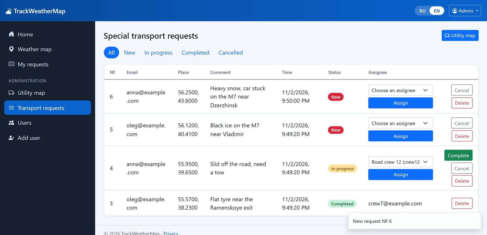
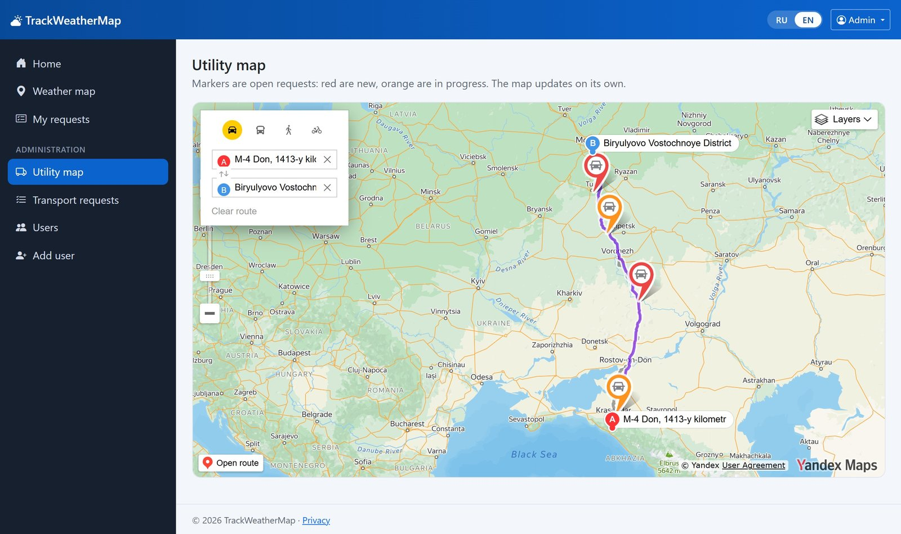

# TrackWeather

[](https://github.com/qwiklly/TrackWeather/actions/workflows/ci.yml)

TrackWeather — это приложение для мониторинга погодных условий и планирования маршрутов с учётом изменений погоды. Оно предназначено для путешественников и технических служб, таких как службы экстренной помощи, которым необходимо оперативно реагировать на изменения погоды.

**Технологии:** ASP.NET Core 10 (Razor Pages и Web API), EF Core, SQL Server, SignalR, Polly, Serilog, xUnit, Docker и GitHub Actions.



Приложение учитывает прогноз погоды на протяжении всего маршрута и предупреждает об опасных условиях: гололёде, снегопаде, сильном дожде и ветре, плохой видимости и грозе. Кроме того, пользователь может изменить время выезда и сравнить новый прогноз с исходным.



На опасных участках можно отправить заявку диспетчеру. Он назначит дорожную бригаду, а статус заявки будет обновляться автоматически.

<p>
  
  
</p>

Интерфейс представлен на русском и английском языках. [README in English](README.md)

## Запуск

Понадобятся ключи [Яндекс Карт](https://developer.tech.yandex.ru) и [OpenWeather](https://openweathermap.org/api).

### Запуск через Docker

```bash
cp .env.example .env    # и заполните его
docker compose up --build
```

После этого откройте http://localhost:5180. Документация API находится на вкладке `/swagger`.

### Запуск без Docker

Нужны .NET 10 SDK и SQL Server. Строка подключения лежит в `appsettings.Development.json`.

```bash
cd TrackWeatherWeb
dotnet user-secrets set "YandexMaps:ApiKey" "ваш-ключ"
dotnet user-secrets set "OpenWeatherApi:ApiKey" "ваш-ключ"
dotnet ef database update
dotnet run --launch-profile https
```

В новой локальной базе уже есть аккаунт `admin@example.com` с паролем `Admin123`. Этот пароль работает только в режиме разработки.

### Запуск тестов

Чтобы запустить тесты, выполните:

```bash
dotnet test
```
